# 라멥

라멥은 라멘 전문점을 찾고 저장하며, 방문 리뷰와 매장 소식·이벤트를 확인하는 Android·iOS 앱입니다.

<a href="https://www.instagram.com/ramap.app/">Instagram</a> ·
<a href="https://ramap-orgranization.github.io/Ramap-Landing-Page/">랜딩 페이지</a> ·
<a href="https://play.google.com/store/apps/details?id=com.peto.ramap">Android 다운로드</a> ·
<a href="https://apps.apple.com/kr/app/%EB%9D%BC%EB%A7%B5/id6797046935">iOS 다운로드</a>

## 소개 및 협업

### 라멥 × 웅성

라멘 인플루언서 [웅성(@menolic.sw)](https://www.instagram.com/menolic.sw/)님과 전국 라멘 매장을 함께 조사했습니다. 웅성님의 조사 방법과 라멘 지식을 바탕으로 검색 범위를 동 단위로 세분화하고, 중식으로 분류된 매장까지 살펴 기존 검색에서 놓친 라멘집을 찾았습니다.

협업 당시 확보한 매장 정보는 **800곳에서 1,400곳 이상**으로 늘었습니다.

> **머니그라피에서 소개된 라멥**
>
> 협업 파트너 웅성님이 머니그라피에 출연해 라멥의 개발과 서비스 운영 사례를 소개했습니다.
>
> **[라멥 소개 장면 보기 · 1:01:35](https://www.youtube.com/watch?v=Wv7uGRB1xHM&t=3695s)**

<a href="https://www.youtube.com/watch?v=Wv7uGRB1xHM&t=3695s">
    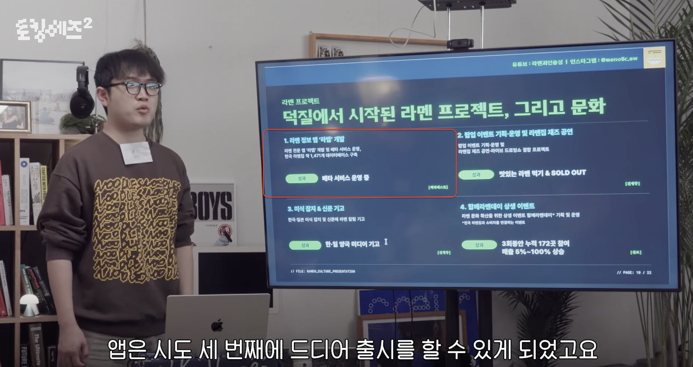
</a>

## 주요 기능

| 기능 | 할 수 있는 일 |
| --- | --- |
| 지도·검색 | 지역과 매장 이름으로 라멘 전문점을 찾고 상세 정보 확인 |
| 매장 정보·메뉴 | 메뉴, 영업시간, 임시 휴무·조기 마감 등 운영 변동 확인 |
| 북마크·가져오기 | 방문하고 싶은 매장을 저장하고 외부 매장 목록 가져오기 |
| 리뷰·피드·팔로우 | 방문 경험을 남기고 전체·저장한 매장·팔로잉의 리뷰 모아보기 |
| 랭킹 | 매장 순위를 비교하고 관심 매장 저장 |
| 새소식·이벤트 | 매장 소식과 이벤트를 확인하고 원하는 알림 설정 |

### 앱 화면

<table>
    <tr>
        <th width="33%">지도 탐색</th>
        <th width="33%">매장 상세</th>
        <th width="33%">메뉴판</th>
    </tr>
    <tr>
        <td>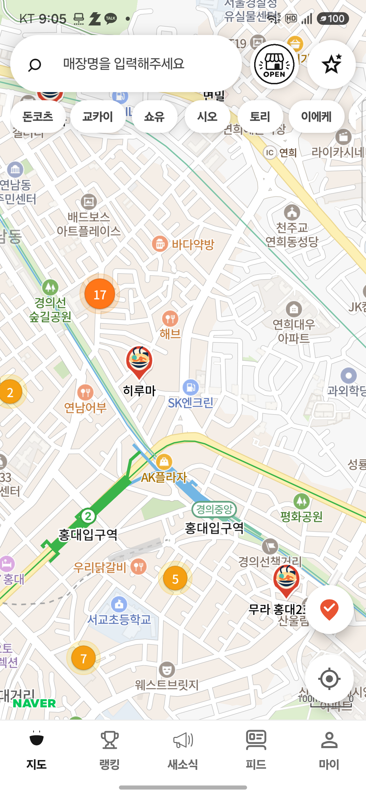</td>
        <td>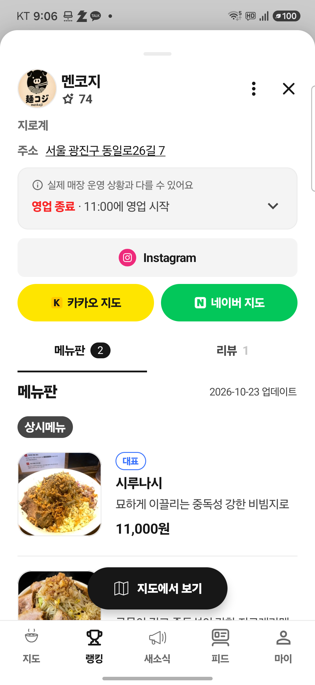</td>
        <td>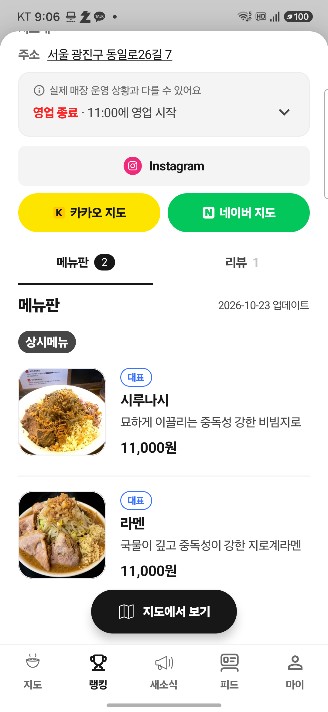</td>
    </tr>
    <tr>
        <th>매장 리뷰</th>
        <th>리뷰 피드</th>
        <th>랭킹</th>
    </tr>
    <tr>
        <td>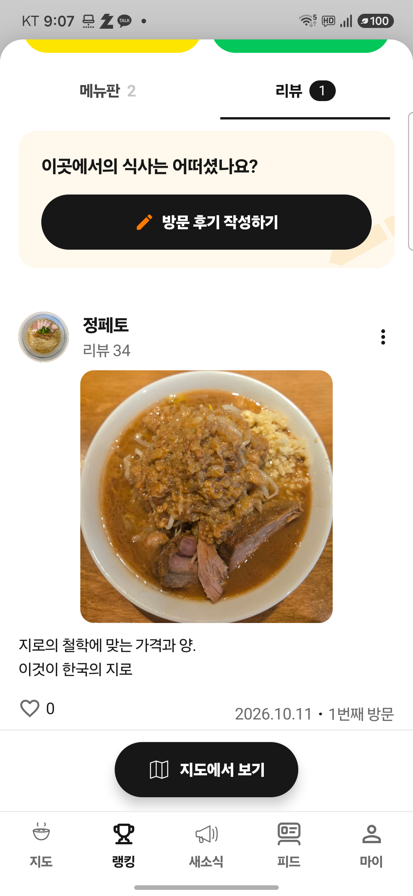</td>
        <td>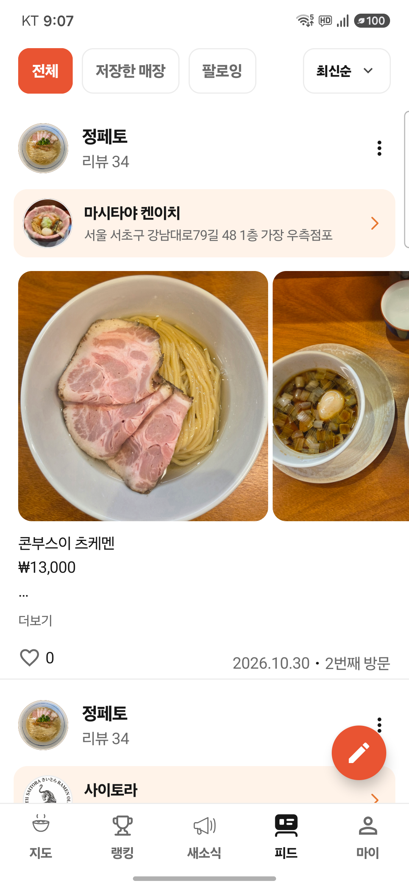</td>
        <td>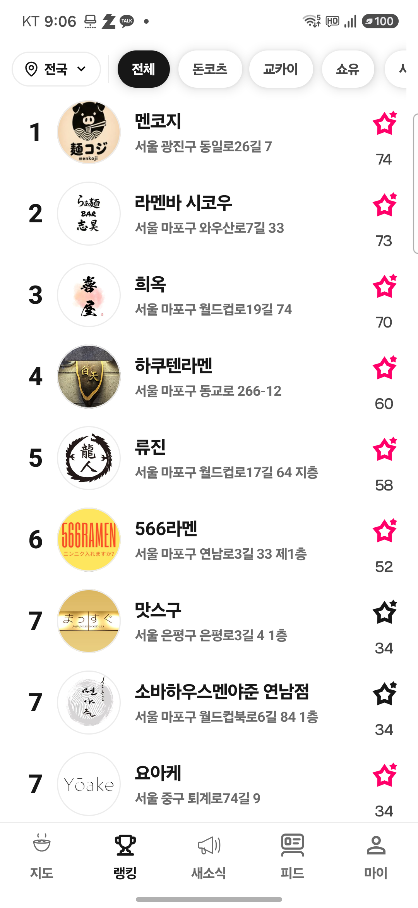</td>
    </tr>
    <tr>
        <th>이벤트 목록</th>
        <th>이벤트 상세</th>
        <th>운영 변동</th>
    </tr>
    <tr>
        <td>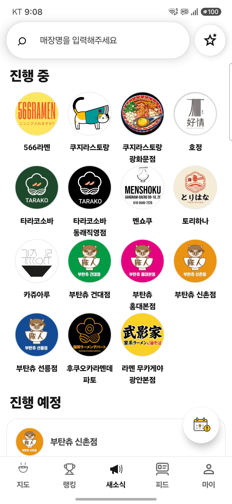</td>
        <td>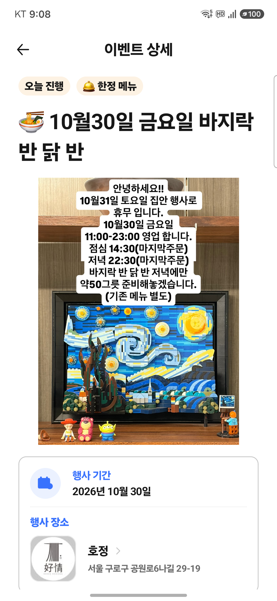</td>
        <td>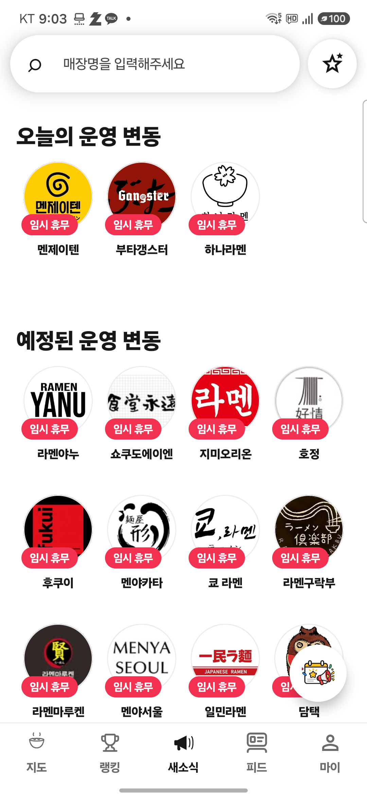</td>
    </tr>
</table>

## 기술 스택

| 구분 | 기술 |
| --- | --- |
| 멀티플랫폼 | Kotlin Multiplatform, Android, iOS |
| UI | Compose Multiplatform, Jetpack Compose, Material 3 |
| 아키텍처 | Clean Architecture, Feature-based Modularization |
| 상태 관리 | Kotlin Coroutines, Flow, StateFlow, MVI 스타일 단방향 상태 관리 |
| 의존성 주입 | Koin |
| 네트워크 | Ktor Client, Kotlinx Serialization |
| 백엔드 | Supabase Auth, PostgREST, Storage, Functions |
| 내비게이션 | AndroidX Navigation 3, Navigation Event, 딥링크, Universal Link |
| 지도·위치 | Naver Map SDK, Google Play Services Location |
| 로그인 | Kakao SDK, Apple 로그인(iOS) |
| 분석·모니터링 | Firebase Analytics, Firebase Crashlytics |
| 푸시 알림 | Firebase Cloud Messaging |
| 이미지 | Coil 3 |
| 테스트 | Kotlin Test, Coroutines Test, Turbine, Compose UI Test, Robolectric |
| 코드 품질 | Ktlint |
| 빌드 | Gradle Convention Plugin, BuildKonfig |
| 개발 환경 | Kotlin `2.4.10`, AGP `9.3.0`, Gradle `9.5.0`, JDK 17 |

세부 라이브러리 버전은 [버전 카탈로그](gradle/libs.versions.toml), Gradle 실행 버전은 [Wrapper 설정](gradle/wrapper/gradle-wrapper.properties)에서 관리합니다.

## 프로젝트 구조

Kotlin 공통 코드에서 화면·도메인·데이터 흐름을 공유하고, 플랫폼 SDK 연결은 각 모듈의 `androidMain`·`iosMain`과 앱 진입점에서 담당합니다.

| 계층 | 모듈 | 역할 |
| --- | --- | --- |
| 앱 | `androidApp` | Android 앱 진입점, Firebase·Kakao·Naver SDK 초기화 |
| 앱 | `iosApp` | iOS 앱 진입점, SwiftUI 및 플랫폼 이벤트 처리 |
| 앱 조립 | `shared` | Koin 초기화, 공통 루트 UI·라우팅·플랫폼 연결 |
| 화면 기능 | `feature/*` | 지도, 매장 상세·메뉴, 리뷰·피드, 랭킹, 새소식, 북마크 등 |
| 데이터 | `data` | DataSource, DTO, Repository 구현, Supabase 연동 |
| 도메인 | `domain` | 도메인 모델, Repository 계약, Use Case |
| 공통 기반 | `core/common`, `core/ui` | 결과·오류 모델, 공통 ViewModel·UI 상태, 로딩·오류 처리 |
| UI 기반 | `core/designsystem`, `core/preview` | 공통 Compose 컴포넌트·테마·리소스, 미리보기 데이터 |
| 네트워크 | `core/network` | Ktor·Supabase 클라이언트와 설정 |
| 내비게이션 | `core/navigation` | Navigation 3, 탭·백스택·딥링크 |
| 플랫폼 | `core/platform` | Android·iOS 플랫폼 기능 추상화 |
| 분석·알림 | `core/analytics`, `core/notification` | 분석·오류 수집, 푸시 알림과 알림 딥링크 |
| 테스트 | `core/testing` | 테스트용 Fake와 Fixture |
| 개발 도구 | `debug/admin` | Android 디버그 빌드용 관리자 도구 |

전체 모듈 목록은 [settings.gradle.kts](settings.gradle.kts), 계층별 책임과 의존 방향은 [아키텍처 규칙](.agents/skills/ramap-architecture/SKILL.md)에서 확인합니다.

## AI 에이전트 하네스

Codex 에이전트가 개발과 운영 작업을 수행할 때 참고할 지침, 역할, 워크플로를 저장소에서 관리합니다. 총괄 에이전트는 일반 구현 요청의 조사·구현·검증을 담당합니다. `/impl`처럼 단계별 진행을 요청하면 작업 범위와 완료 기준을 정해 역할별 에이전트로 이어갑니다.

| 구성 | 책임 |
| --- | --- |
| [공통 작업 지침](AGENTS.md) | 작업 범위, 일반 요청과 전용 절차의 분기, 기존 변경 보존 |
| [작업 스킬](.agents/skills/) | 구현 규칙과 계획·리뷰·릴리스 등 재사용 가능한 절차 |
| [역할별 에이전트 설정](.codex/agents/) | 각 역할의 책임, 모델·추론 수준, 실행 지침 |
| [정책·도메인 위키](docs/wiki/README.md) | 제품 규칙, 도메인 개념·관계·예외, 결정 이유 |
| [메뉴 최신화 도구](tools/menu-refresh/README.md) | 수집·판정·반영·검토에 쓰는 도구와 재개 절차 |

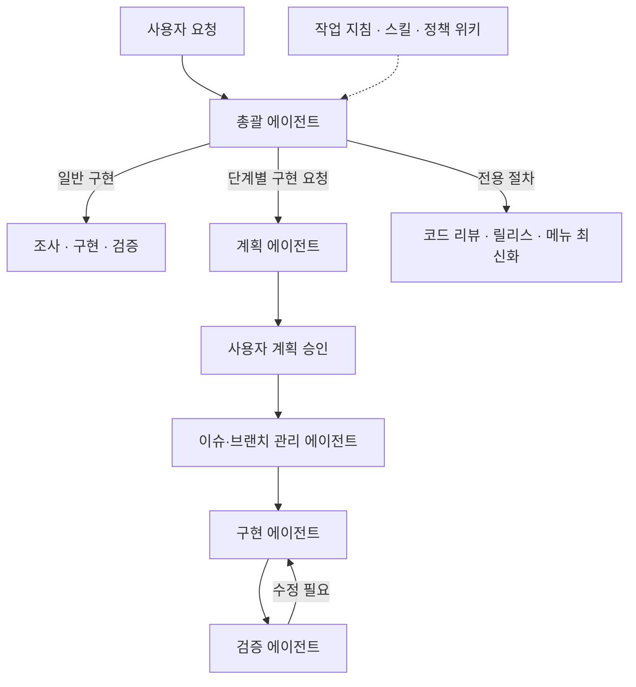

단계별 구현의 상세 계약은 [계획·승인·구현 스킬](.agents/skills/source-command-impl/SKILL.md)에 있습니다. 검증 결과와 필요한 수정은 담당 에이전트에 전달하며, 전용 작업은 다음과 같이 나눕니다.

| 작업 | 역할과 확인 지점 |
| --- | --- |
| [코드 리뷰](.agents/skills/ramap-review/SKILL.md) | 코드 리뷰 에이전트가 변경·호출 경로·상태 전이·테스트를 읽기 전용으로 검토 |
| [릴리스](.agents/skills/release/SKILL.md) | 릴리스 관리 에이전트가 빌드·검증·미리보기를 준비하고, 사용자 승인 후 게시·스토어 심사 제출 |
| [메뉴 최신화](tools/menu-refresh/SKILL.md) | 메뉴 수집 에이전트와 메뉴 판정 에이전트가 근거와 변경안을 준비하고, 총괄 에이전트가 DB에 반영한 뒤 별도 메뉴 등록 검토 에이전트가 독립 대조 |
