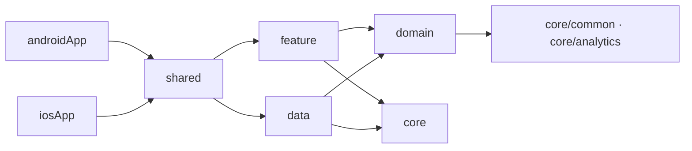

# 아키텍처 탐색

계층 책임과 허용 의존성의 규칙은 로컬 `.agents/skills/ramap-architecture/SKILL.md`가 소유합니다. 아래는 현재 코드를 읽기 위한 지도입니다.

## 조립과 호출 경계

이 그림은 주요 연결의 요약이며 전체 Gradle 의존성 그래프가 아닙니다. 실제 선언은 [shared](../../shared/build.gradle.kts), [data](../../data/build.gradle.kts), [domain](../../domain/build.gradle.kts)의 build 파일을 확인합니다.

| 관심사 | 실제 출발점 |
| --- | --- |
| 앱 조립과 feature 연결 | [KoinInitializer](../../shared/src/commonMain/kotlin/com/peto/ramap/di/KoinInitializer.kt), [AppModule](../../shared/src/commonMain/kotlin/com/peto/ramap/di/AppModule.kt) |
| 화면 상태와 사용자 입력 | [feature](../../feature), [BaseViewModel](../../core/ui/src/commonMain/kotlin/com/peto/ramap/ui/base/BaseViewModel.kt) |
| 도메인 계약과 동작 | [repository 계약](../../domain/src/commonMain/kotlin/com/peto/ramap/domain/repository), [모델](../../domain/src/commonMain/kotlin/com/peto/ramap/domain/model), [usecase](../../domain/src/commonMain/kotlin/com/peto/ramap/domain/usecase) |
| 데이터 구현과 변환 | [repository 구현](../../data/src/commonMain/kotlin/com/peto/ramap/data/repository), [datasource](../../data/src/commonMain/kotlin/com/peto/ramap/data/datasource), [DTO](../../data/src/commonMain/kotlin/com/peto/ramap/data/model) |
| Android와 iOS 연결 | [플랫폼 모듈](../../core/platform), [공통 루트](../../shared), [실행 흐름](app-flows.md) |
| Android 디버그 관리 도구 | [admin 모듈](../../debug/admin/build.gradle.kts), [앱의 debugImplementation](../../androidApp/build.gradle.kts) |

## 현재 의존성과 데이터 접근

현재 `domain`은 `core/common`과 `core/analytics`에 의존합니다. [SignInUseCase](../../domain/src/commonMain/kotlin/com/peto/ramap/domain/usecase/SignInUseCase.kt)가 공통 로그인 분석 API를 사용하고, [SignInUseCaseTest](../../domain/src/commonTest/kotlin/com/peto/ramap/domain/usecase/SignInUseCaseTest.kt)가 성공·실패 이벤트를 확인합니다. Firebase SDK 호출은 analytics 모듈의 플랫폼 구현에 있습니다.

리소스 표현의 연결은 [core/ui](../../core/ui/build.gradle.kts) → [core/designsystem](../../core/designsystem/build.gradle.kts) → domain입니다. mapper의 실제 소유 위치는 [디자인시스템 문서](design-system.md)에 있습니다. 이 배치와 analytics 의존성을 현재 기준으로 확정하고 소유 스킬에 반영했습니다([DEC-0002](decisions.md#dec-0002-현재-구현을-기준으로-개발-규칙-정합성-확정)).

데이터 계층의 로그인·알림 설정·푸시 등록 repository는 Supabase client를 직접 사용하므로 모든 repository가 datasource를 경유한다고 일반화하면 안 됩니다. 새 데이터 접근의 배치는 소유 스킬을 따르고, 기존 직접 접근을 변경할 때는 호출부·DI·테스트를 함께 확인합니다.
